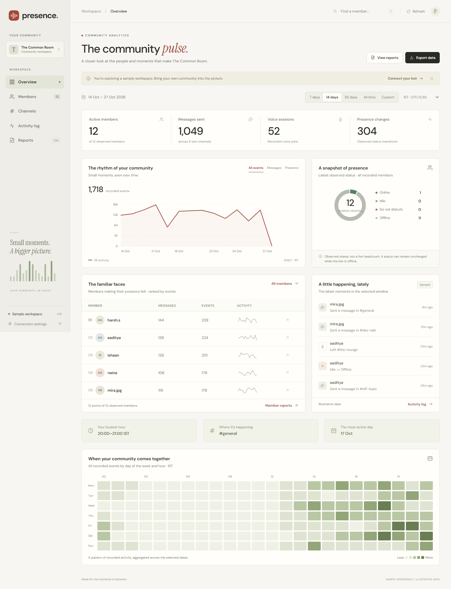

# Discord Presence Bot

A Python Discord bot with **Presence**, a live dashboard for community activity, member reports, and channel analytics. The dashboard uses a warm paper palette, quiet typography, and charts built without a frontend chart dependency.

Discord does not supply historical presence data. The bot records future activity while it is running; your existing records stay in SQLite on the backend host.

[Bot setup and commands](docs/BOT_GUIDE.md) · [Local dashboard](#run-locally) · [Railway and Vercel](#connect-an-existing-railway-backend-to-vercel)



*The preview uses illustrative data. Connect your own API to view your community.*

## Run locally

```powershell
python api_server.py
```

Open **http://localhost:5000**. The API reads `presence.db` beside the script, including committed WAL data, without changing the schema. Keep `bot.py` running separately to collect new activity. The frontend checks for new data every 30 seconds while the tab is visible. API connectivity does not establish that the bot is running.

**Connection settings** accepts another API address, a community name, and an optional dashboard access token. Tokens stay in the browser tab's session storage. Sample mode is explicitly labelled throughout the UI, exported files, and printed reports. Use `http://localhost:5000/?demo=1` for a design preview; choose Connection settings to return to your real bot.

## What's included

- Overview with date ranges, activity chart, observed status breakdown, contributors, recent events, and activity heatmap.
- Searchable member directory, status filters, individual reports, active windows, and per-member activity.
- Channel metrics, contribution breakdowns, and channel drilldowns.
- Searchable, paginated event log covering messages, reactions, voice events, and presence changes.
- Community, member, and channel reports with CSV, JSON, and print-to-PDF. Event exports include all matches across all pages.
- UTC and IST date boundaries, custom date ranges, mobile navigation, keyboard focus, reduced-motion support, and `/` to search members.

## Deploy the frontend to Vercel

Import this repository. The included `vercel.json` builds with `npm run build` and publishes **only `dist/`**. No install is required. The build copies an explicit allowlist of six static files; the bot, database, reports, exports, and secrets are not included.

Set these Vercel build environment variables if you want a default connection:

| Variable | Value |
| --- | --- |
| `PRESENCE_API_URL` | Your API's HTTPS origin, e.g. `https://presence-api.example.com` |
| `PRESENCE_SERVER_NAME` | Optional display name for your community |

You can also set the API address through Connection settings after deployment. Browser settings take precedence over build defaults. A static deployment with no configured API opens a clearly labelled sample workspace. A failed configured connection shows an error and never substitutes sample records.

**Host the bot and SQLite API together on persistent storage.** A Vercel static frontend cannot directly open the SQLite file on your computer, and Vercel Functions do not provide shared persistent storage for a live SQLite database. See [Vercel's SQLite guidance](https://vercel.com/kb/guide/is-sqlite-supported-in-vercel). Expose your API over HTTPS and point the frontend at it. This repository does not move or upload your database.

Configure the API host using environment variables:

```powershell
$env:HOST = '0.0.0.0'
$env:PORT = '5000'
$env:PRESENCE_DB_PATH = 'D:\path\to\presence.db'
$env:DASHBOARD_ORIGIN = 'https://your-dashboard.vercel.app'
$env:DASHBOARD_API_TOKEN = 'choose-a-long-random-dashboard-access-token'
python api_server.py
```

Place the API behind your host's HTTPS reverse proxy. `DASHBOARD_API_TOKEN` is a separate dashboard credential, **never your Discord bot token**. With this variable set, all `/api/*` reads require `Authorization: Bearer <token>`. Without it, anyone who can reach the API can read dashboard records. CORS controls browser origins; it is not authentication. The default API binds only to `127.0.0.1`.

For server names from the API, optionally set `DASHBOARD_GUILD_NAMES` to a JSON map of Discord server IDs to names. The bot's database does not store server names, avatars, or total guild membership, so the UI uses initials and observed members.

## Connect an existing Railway backend to Vercel

Keep the bot and API in the **same Railway service**, reading the same SQLite file. The existing `Procfile` starts only `bot.py`; a running Discord bot alone does not expose the dashboard API. These steps require deploying the updated `api_server.py` from this checkout. `railpack.json` explicitly selects Python for Railway so the frontend's `package.json` does not change its build stack. Vercel uses the separate `vercel.json` configuration.

1. In your existing Railway service, keep the current Python build configuration. If the API is not already started, set **Settings → Start Command** to:

   ```sh
   sh -c 'python -u api_server.py & exec python -u bot.py'
   ```

   Both commands run from the project root. This starts the API alongside the existing bot rather than creating another bot service.

2. Add the following **Railway variables**, preserving your existing `DISCORD_TOKEN`:

   | Variable | Value |
   | --- | --- |
   | `HOST` | `0.0.0.0` |
   | `DASHBOARD_API_TOKEN` | A separate long random dashboard access token |
   | `DASHBOARD_ORIGIN` | Your exact production Vercel origin, e.g. `https://your-project.vercel.app`, without a trailing slash |
   | `PRESENCE_DB_PATH` | Optional: the absolute path of the SQLite file your bot already writes |

   The API reads Railway's `PORT` automatically. With both scripts in the same project root, leaving `PRESENCE_DB_PATH` unset reads the same `presence.db` as the bot. The current bot uses a relative database path and does **not** read `PRESENCE_DB_PATH`; setting that variable only changes the API's path. Preserve your current database location and volume mount. Confirm that the actual database is on persistent storage before redeploying; a volume mounted elsewhere does not automatically persist this file. [Railway volume guide](https://docs.railway.com/volumes)

3. In Railway, open **Settings → Networking → Public Networking → Generate Domain**. Use an existing public domain if you already have one. Its target port must match the API's `PORT`. Railway provides the HTTPS address; use that public address rather than a `.railway.internal` hostname. [Public networking](https://docs.railway.com/networking/public-networking)

4. Check that `https://YOUR-RAILWAY-DOMAIN/api/meta` returns the version-1 API response. With the access token configured, an unauthenticated browser request returns **401**, which confirms that the API is reachable but protected. To check the actual response without putting the token in command history, run this locally in PowerShell:

   ```powershell
   $dashboardCredential = Get-Credential -UserName dashboard -Message 'Enter your dashboard access token as the password'
   $dashboardHeaders = @{ Authorization = 'Bearer ' + $dashboardCredential.GetNetworkCredential().Password }
   Invoke-RestMethod -Uri 'https://YOUR-RAILWAY-DOMAIN/api/meta' -Headers $dashboardHeaders
   Remove-Variable dashboardCredential, dashboardHeaders
   ```

   A valid response contains `version`, `guilds`, `first_event`, and `last_event`. Do not use your Discord bot token for this request.

5. Import the GitHub repository into Vercel with these settings:

   | Setting | Value |
   | --- | --- |
   | Framework preset | Other |
   | Root directory | Repository root |
   | Build command | `npm run build` |
   | Output directory | `dist` |
   | Production branch | `main` |
   | Environment variable `PRESENCE_API_URL` | `https://YOUR-RAILWAY-DOMAIN` with no `/api` suffix |
   | Environment variable `PRESENCE_SERVER_NAME` | Optional community name |

   Set the variables for Production and, if wanted, Preview. Deploy after adding or changing them: they are compiled into the static configuration during the build. `vercel.json` already declares the build command and output directory. [Vercel environment variables](https://vercel.com/docs/environment-variables)

6. Open the deployed dashboard → **Connection settings**. Confirm the Railway API address, enter the **dashboard** access token, and choose **Connect to my bot**. This also switches a previously selected sample workspace back to real data. The token belongs in this connection dialog, not in `PRESENCE_API_URL`, `assets/config.js`, or any public build asset. When connected, the sidebar says **API connected** and the visible tab refreshes every 30 seconds.

If you deployed Vercel before choosing its production URL, set `DASHBOARD_ORIGIN` on Railway to that final URL and redeploy the Railway service. A custom Vercel domain must match this value exactly.

| Symptom | Check |
| --- | --- |
| Railway 502 | API process is running, `HOST=0.0.0.0`, and domain target port matches `PORT` |
| `/api/meta` returns 404 | Railway is serving the old API or a different service; deploy this updated API |
| 401 after connecting | Dashboard token matches `DASHBOARD_API_TOKEN` |
| 503 database unavailable | API points at the bot's actual SQLite file and can read it |
| Browser CORS error | `DASHBOARD_ORIGIN` equals the Vercel website origin, including `https://` |
| API connects but period is empty | Try All time and confirm the bot has recorded events for this server |
| Sample workspace remains selected | Connection settings → enter the Railway address/token → Connect to my bot |

## Data contract and calculations

`GET /api/meta` returns version `1`, available guild IDs/names, first/last observations, and the API generation time. `GET /api/snapshot?guild_id=…&from=…&to=…` returns `meta`, `members`, `presence_logs`, and `channel_logs`. Dates are timezone-aware ISO timestamps; `from` is inclusive, `to` is exclusive. The response declares `meta.complete: true`, preserves Discord IDs as strings, excludes opted-out members, and uses one consistent read transaction.

Presence records include six hours of context before `from`, plus each member's preceding observed state, so sessions can cross the report boundary without restarting already capped sessions. Context does not count toward event totals. Windows above 100,000 combined records return HTTP 413 with an instruction to narrow the period. Records are never silently truncated. The original `/api/stats`, `/api/presence`, `/api/channels`, and `/api/leaderboard` routes remain available.

**Active members** have at least one event in the selected period. **Voice sessions** count voice joins, not inferred voice duration. **Estimated active time** merges consecutive online/DND states until idle/offline, caps each continuous session at six hours, and clips it to the selected period and current time. The frontend derives these estimates from transitions rather than the bot's historical `daily_stats` estimates. Missing observations remain unknown. Status distribution uses the latest observed member states, independent of the report period; it is not a live online headcount.

The heatmap counts all recorded event types in the selected timezone. CSVs escape quoted fields and neutralize spreadsheet formulas. Import Discord ID columns as **text** to preserve all digits in spreadsheet applications.

## Verify

```powershell
npm test
python -m unittest discover -s tests -p "test_*.py"
npm run build
```

The data tests cover session boundaries, timezone bucketing, member isolation, export safety, and reconciliation. API tests use a temporary database and never modify `presence.db`.

For the optional end-to-end browser check, install Playwright and its Chromium browser, keep the local API running, and run `python tests/browser_check.py`. It saves screenshots and downloaded test reports in the ignored `.artifacts/` directory.

## License

MIT License.
