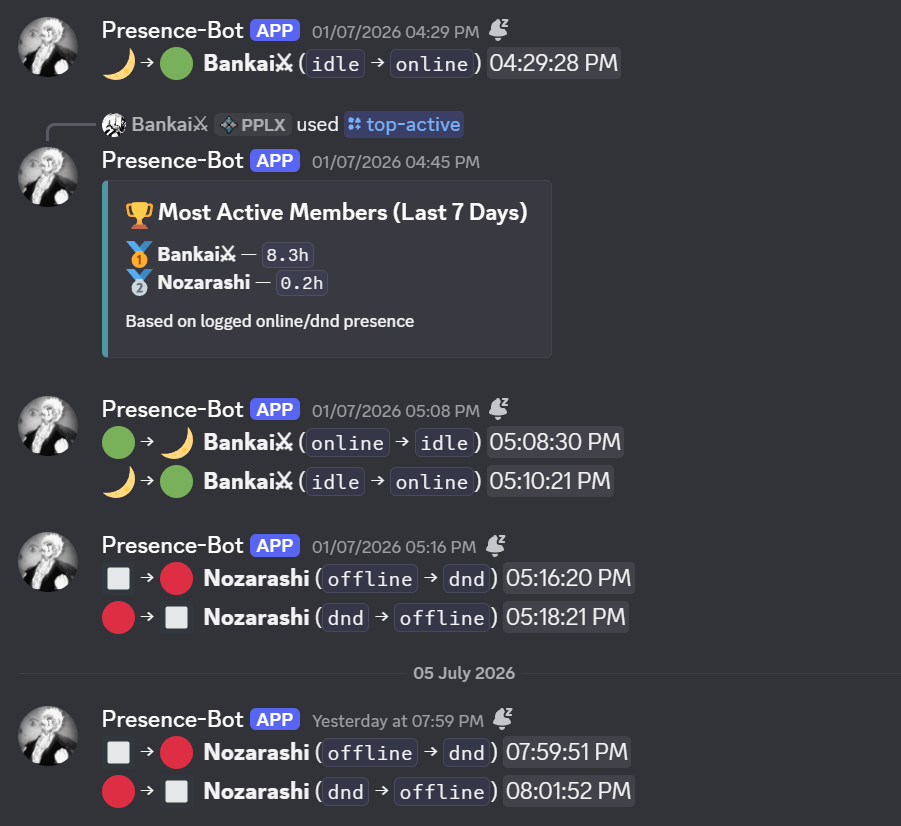

# Discord bot setup

The bot records presence changes and channel activity while it is running. Discord does not provide historical presence data; events missed while the bot is offline cannot be recovered.

## Install

Use Python 3.11 or newer and create a virtual environment:

```powershell
python -m venv .venv
.venv\Scripts\Activate.ps1
pip install -r requirements.txt
```

The bot uses discord.py and SQLite. Matplotlib, NumPy, and Pandas support the bot's reports and charts. The dashboard API itself uses Python's standard library.

## Configure Discord

Create an application in the [Discord Developer Portal](https://discord.com/developers/applications), create its bot, and invite it to your server with the `bot` and `applications.commands` scopes.

Enable **Presence Intent** and **Server Members Intent** under the bot's privileged gateway intents. Enable **Message Content Intent** for message-content-dependent commands. Grant the bot access to the channels where it should operate and post reports.

Set the token in your process environment, then start the bot:

```powershell
$env:DISCORD_TOKEN = 'YOUR_BOT_TOKEN'
python bot.py
```

The current code reads `DISCORD_TOKEN` from the environment; it does not automatically load a `.env` file. On Railway, add the token in the service's Variables settings instead. Never commit the real token.

## Set report channels

In Discord, run:

```text
/setup log_channel:#presence-logs report_channel:#reports
```

Presence logs can look like this:



## Slash commands

| Command | Purpose |
| --- | --- |
| `/activity` | Member activity summary |
| `/heatmap` | Member activity heatmap |
| `/daily-chart` | Daily online-time chart |
| `/guild-heatmap` | Server activity heatmap |
| `/top-active` | Most active members |
| `/channel-stats` | Channel activity summary |
| `/user-channel-log` | Per-member channel events for admins |
| `/export-csv` | Presence export for admins |
| `/bot-status` | Bot and database status |
| `/privacy optout` | Stop recording your future activity |
| `/privacy optin` | Resume recording your future activity |

The bot currently uses an invisible Discord status while running. An offline-looking bot profile does not establish whether the process is running; check the service logs or `/bot-status`.

## Data and hosting

The bot stores guild/member IDs, usernames, observed status changes, timestamps, and channel-event metadata in `presence.db`. Its message handler records message length rather than message text. Presence data describes observed events, not a complete attendance record.

SQLite must live on persistent storage for history to survive a deployment. The current bot writes the relative path `presence.db` in its working directory. The dashboard API must read that same database; its `PRESENCE_DB_PATH` setting does not move the bot's database.

Keep one bot instance per token. For dashboard hosting, API authentication, SQLite path handling, and Railway-to-Vercel setup, see the [main README](../README.md#connect-an-existing-railway-backend-to-vercel).

## Troubleshooting

- **No presence events:** check the privileged intents, bot configuration, and whether a member actually changed status after the bot started.
- **Missing SQLite tables:** start the bot so `init_db()` can initialize the schema before reading reports.
- **No events during downtime:** this is expected; Discord does not supply historical presence changes.
- **Dashboard unavailable:** run `python api_server.py` and open its HTTP address. This dashboard uses JavaScript modules and should be served over HTTP rather than opened as a file.
- **Local or hosted setup:** the complete dashboard and deployment instructions are in the [main README](../README.md).
